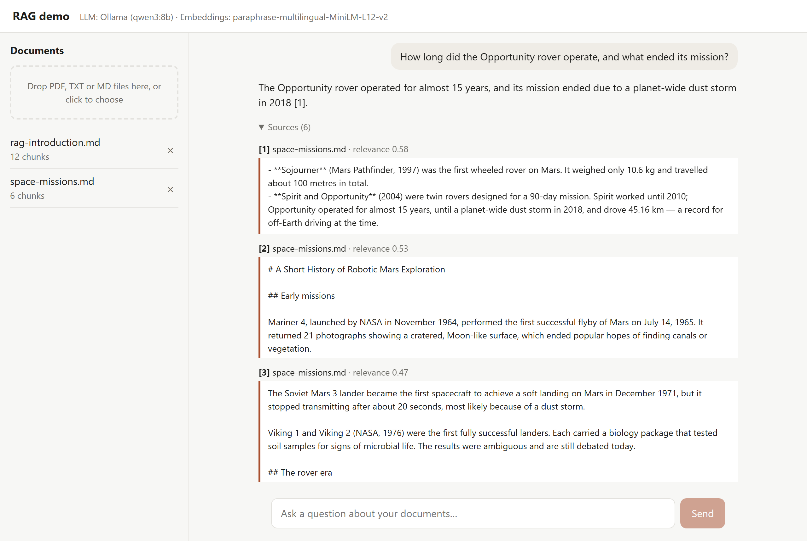
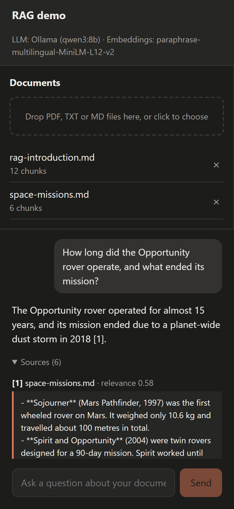
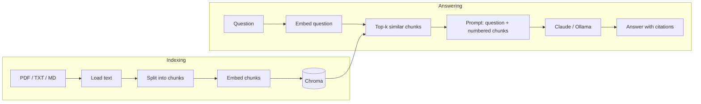

# RAG demo — chat with your documents

A small, readable **Retrieval-Augmented Generation** app: upload PDF / TXT / Markdown files and ask questions about them. Answers are generated by an LLM **only from the retrieved fragments** of your documents and cite their sources.

- 🔁 **Swappable LLM** — Claude (Anthropic API) or a local model via Ollama, one line in `.env`
- 🌍 **Multilingual retrieval** — ask in Polish about English documents (and vice versa)
- 🔒 **Local embeddings** — documents are embedded on your machine with [fastembed](https://github.com/qdrant/fastembed); only the retrieved fragments are sent to the LLM
- ⚡ **Streaming answers** over Server-Sent Events, with a preview of every source fragment and its relevance score

**Stack:** Python 3.13 · FastAPI · LangChain · Chroma · fastembed · React 19 · TypeScript · Vite · Docker Compose · nginx

<p align="center">
  
  
</p>

## How it works



1. **Load** — text is extracted from the file (PDFs page by page, so citations can point to a page).
2. **Chunk** — `RecursiveCharacterTextSplitter` cuts the text into ~450-character chunks with a 70-character overlap (`CHUNK_SIZE` / `CHUNK_OVERLAP`; the embedding model reads at most 128 tokens), preferring paragraph and sentence boundaries.
3. **Embed** — each chunk becomes a 384-dimensional vector (`paraphrase-multilingual-MiniLM-L12-v2`). Chunks with similar meaning get nearby vectors.
4. **Store** — vectors, text and metadata are persisted in a local Chroma collection (cosine similarity).
5. **Retrieve** — the question is embedded with the same model and the `top_k` closest chunks are returned. Chunks below `min_relevance` are dropped, because a vector store always returns *something* — even for questions unrelated to any document.
6. **Generate** — the chunks are numbered and placed in the system prompt; the LLM answers using only them and cites `[1]`, `[2]`…

## Project structure

```
backend/
  app/
    main.py         creates the FastAPI app: wires app.rag to app.api
    config.py       settings from .env
    api/            HTTP layer
      deps.py       shared dependencies (settings, RagService)
      guards.py     Origin check + body size limit, before the body is read
      schemas.py    request / response models
      sse.py        Server-Sent Events formatting
      routes/       health.py, documents.py (upload), chat.py (SSE stream)
    rag/            the RAG pipeline, independent of FastAPI
      service.py    RagService: index, retrieve, generate
      ingest.py     loading + chunking
      embeddings.py fastembed adapter for LangChain
      llm.py        LLM factory (Claude / Ollama)
      prompts.py    system prompt + how fragments go into it
      citations.py  drops [n] citations that point at no source
      models.py     dataclasses shared with the API
  sample_docs/      indexed automatically on first start
  tests/            pytest (api/, rag/), runs offline with fake LLM and embeddings
  Dockerfile        Python image running uvicorn
frontend/
  src/
    api.ts          backend client + SSE stream parser
    components/     DocumentPanel, Chat
  scripts/          screenshots.mjs - retakes docs/screenshots (make shots)
  Dockerfile        builds the app, serves it with nginx
  nginx.conf        static files + /api proxy (unbuffered, for streaming)
docs/screenshots/   the README images
docker-compose.yml  backend + frontend (+ optional Ollama)
Makefile            setup / dev / test / lint / check / up / down / shots
```

## Getting started

You need an [Anthropic API key](https://console.anthropic.com) **or** [Ollama](https://ollama.com) for the LLM. Configuration lives in `backend/.env` - copy [`backend/.env.example`](backend/.env.example) and set `ANTHROPIC_API_KEY`, or `LLM_PROVIDER=ollama` (see [Using Ollama](#using-ollama-instead-of-claude)).

### Option A: Docker - run the app

Requires only [Docker](https://docs.docker.com/get-docker/).

```bash
cp backend/.env.example backend/.env    # then edit it
make up                                 # or: docker compose up --build -d
```

Open http://localhost:8080. `make logs` follows the logs, `make down` stops the app; the index and the embedding model are kept in the `rag-data` volume. The first start downloads the embedding model (~220 MB) and indexes the files from `sample_docs/`.

The app has no login, so it only listens on this machine. To open it to your network, start it with `BIND_ADDRESS=0.0.0.0 make up` and add the address you browse to (e.g. `http://192.168.1.10:8080`) to `CORS_ORIGINS` in `backend/.env` - anyone who can reach it can then read and delete your documents.

### Option B: local development

Requires Python **3.13** (newer versions may still lack prebuilt wheels for numpy / onnxruntime), Node.js **20.19+ or 22.12+** (Vite's requirement; CI and Docker use 24) and `make` (on Windows: `winget install ezwinports.make`, with [Git for Windows](https://gitforwindows.org) installed - the Makefile runs its recipes with Git's `sh`; if Git is not in `C:\Program Files\Git`, pass `make GIT_USR_BIN=<your Git>/usr/bin ...`).

```bash
make setup    # venv + Python deps, npm packages, backend/.env, git hooks
make dev      # backend on :8000 and frontend on :5173 with auto-reload; Ctrl+C stops both
```

Open http://localhost:5173 (API docs: http://localhost:8000/docs). Run `make` to list all commands:

| Command | What it does |
|---|---|
| `make setup` | Install all dependencies, create `backend/.env`, install git hooks |
| `make dev` | Run backend and frontend with auto-reload (`make dev-backend` / `make dev-frontend` for one) |
| `make test` | Backend tests |
| `make lint` / `make format` | Ruff + oxlint / Ruff + Prettier |
| `make check` | CI's checks: lock files up to date, lint, format check, tests, frontend build (CI also builds the Docker images) |
| `make up` / `make down` / `make logs` | The Docker app |
| `make shots` | Retake the screenshots above (`docs/screenshots/`, overwritten): a [Playwright](https://playwright.dev) script starts its own backend with only the sample documents, asks one question with the LLM set in `backend/.env` and captures desktop (light) and phone (dark). Needs `make setup` and a working LLM (Ollama running, or an API key - one paid Claude call). The first run downloads a headless Chromium into Playwright's cache outside the repo; on Linux, if it fails to start, run `cd frontend && sudo npx playwright install-deps chromium` once |
| `make lock` | After editing `backend/requirements*.in`: re-pin every Python dependency, transitive ones included, into `requirements*.txt` (versions already in the lock are kept; `make lock-upgrade` moves them to new releases, `P=<package>` for one) with [uv](https://docs.astral.sh/uv/) - one lock for every OS, so a lock made on Windows fits the Linux Docker image. `make lock-check` (part of `make check` and CI) fails when the `.txt` files are out of date with the `.in` files |

<details>
<summary>Without make</summary>

```bash
cd backend
python3.13 -m venv .venv            # Windows: py -V:3.13 -m venv .venv
source .venv/bin/activate           # Windows: .venv\Scripts\activate
pip install -r requirements-dev.txt
cp .env.example .env
uvicorn app.main:create_app --factory --reload --reload-dir app

# second terminal
cd frontend
npm ci
npm run dev
```

</details>

### Using Ollama instead of Claude

```bash
ollama pull qwen3:8b
```

and in `backend/.env`:

```env
LLM_PROVIDER=ollama
OLLAMA_MODEL=qwen3:8b
```

`qwen3:8b` (5.2 GB) handles non-English questions well and follows the citation format. On a slower machine, `llama3.2` (2 GB) is about twice as fast, but its answers in languages other than English are noticeably worse.

In Docker the backend reaches the Ollama running on your machine through `host.docker.internal`. The URL comes from the `OLLAMA_URL` variable of your shell (default `http://host.docker.internal:11434`) - `OLLAMA_BASE_URL` in `backend/.env` is ignored there, because `localhost` inside a container is the container itself. Without Ollama installed, the compose file can run it in a container too (CPU only unless Docker has GPU access):

```bash
OLLAMA_URL=http://ollama:11434 docker compose --profile ollama up --build -d
docker compose exec ollama ollama pull qwen3:8b
```

## Configuration

All settings live in `backend/.env` (see [`.env.example`](backend/.env.example)):

| Variable | Default | Description |
|---|---|---|
| `LLM_PROVIDER` | `anthropic` | `anthropic` or `ollama` |
| `ANTHROPIC_MODEL` | `claude-opus-5-5` | Claude model id |
| `ANTHROPIC_EFFORT` | `low` | How much the model reasons before answering (`low` … `max`); empty = not sent, for a model without the effort parameter |
| `ANTHROPIC_MAX_TOKENS` | `16000` | Output token limit of one answer; lower it for a model with a smaller limit |
| `OLLAMA_MODEL` | `qwen3:8b` | Any model pulled into Ollama |
| `OLLAMA_BASE_URL` | `http://localhost:11434` | Where Ollama runs (local runs only - see Docker above) |
| `OLLAMA_REASONING` | unset | Thinking mode of reasoning models. Unset = the model's default (works for every model); `true` is rejected by models without one (`llama3.2`); `false` halves the time to first token, but with `qwen3:8b` answers stick less to the documents (it answered an off-topic question from its own knowledge) |
| `CHUNK_SIZE` / `CHUNK_OVERLAP` | `450` / `70` | Chunking parameters (re-index after changing). The embedding model reads at most 128 tokens (~450 characters) and silently ignores the rest of a longer chunk |
| `TOP_K` | `8` | Maximum number of chunks passed to the LLM (8 × 450 characters ≈ the context of 4 × 1000) |
| `MMR_LAMBDA` / `FETCH_K` | `1.0` / `20` | [Maximal Marginal Relevance](https://www.cs.cmu.edu/~jgc/publication/The_Use_MMR_Diversity_Based_LTMIR_1998.pdf): pick `TOP_K` of the `FETCH_K` best chunks that are relevant but not near-duplicates. `1.0` = off; try `0.5` when your documents repeat each other. Off by default: on the sample docs it lost answer chunks and did not help two-topic questions |
| `CORS_ORIGINS` | `localhost` / `127.0.0.1` on ports 5173 and 8080 | Browser origins allowed to upload, delete and chat (JSON list in `.env`). Requests from other websites' pages are blocked (CSRF protection); `curl` and scripts send no origin and are not affected. `"*"` is rejected at startup: list every origin |
| `MAX_UPLOAD_MB` | `10` | Per-file upload limit (indexing a 10 MB text file takes minutes on a CPU). In Docker, nginx also caps a whole upload request at 100 MB (`client_max_body_size` in `frontend/nginx.conf`) |
| `MAX_UPLOAD_FILES` | `20` | Files per upload request |
| `EMBEDDING_MODEL` | `sentence-transformers/paraphrase-multilingual-MiniLM-L12-v2` | Any [fastembed](https://qdrant.github.io/fastembed/examples/Supported_Models/) text model; changing it requires re-indexing (below) |
| `MIN_RELEVANCE` | `0.2` | Chunks with lower relevance (cosine similarity, -1–1; ~0.2 for unrelated text) are ignored. Questions in a different language than the documents score lower, so don't set it too high |

**Re-indexing.** Vectors from different embedding models are not comparable, and chunks keep the size they were cut with, so after changing `EMBEDDING_MODEL`, `CHUNK_SIZE` or `CHUNK_OVERLAP` delete the index and upload your documents again: locally delete `backend/data/chroma` (or `<DATA_DIR>/chroma`); in Docker run `docker compose down` and `docker volume rm rag_rag-data` (the embedding model is downloaded again; `docker compose down -v` would also delete the models of the bundled Ollama). The sample documents are indexed again on the next start. Otherwise they are added only on the first start, so samples you delete stay deleted.

`DATA_DIR` and `MODELS_DIR` move the index and the downloaded embedding model; the frontend dev server reads `API_URL` to proxy to a backend other than `http://localhost:8000`. Together they let a second, isolated instance run next to your own (the `/test` skill uses this). The sample documents are indexed on the first start only; `INDEX_SAMPLES_ON_STARTUP=false` skips them and `SAMPLE_DOCS_DIR` points to another folder.

## API

| Method | Path | Description |
|---|---|---|
| `GET` | `/api/health` | Active LLM and embedding model |
| `GET` | `/api/documents` | Indexed documents |
| `POST` | `/api/documents` | Upload and index files (`multipart/form-data`, field `files`). All-or-nothing: `400` for an unsupported or unreadable file (corrupt or encrypted PDF, no text, not UTF-8), `413` above `MAX_UPLOAD_MB` or `MAX_UPLOAD_FILES` (a body larger than that many files could be is refused before it is read), `411` without `Content-Length` (also for a chunked chat request) |
| `DELETE` | `/api/documents/{doc_id}` | Remove a document from the index |
| `POST` | `/api/chat` | `{"question": "..."}` → SSE stream: `sources`, `token`…, `error`?, `done` |

Uploads, deletes and chat sent from a browser page whose origin is not in `CORS_ORIGINS` are blocked: the upload with `403`, answered before its body is read; delete and chat already fail the browser's CORS preflight.

Answers are rendered as Markdown without images (shown as `[image: …]`) and the Docker frontend sends a strict Content-Security-Policy: text injected into an uploaded document cannot make the page load a remote URL that would carry your question or documents elsewhere.

## Development

### Tests

`make test` runs the backend tests. They use LangChain's fake chat model and deterministic fake embeddings, so they run in seconds without network access or API keys.

### Linting and formatting

| | Lint (`make lint`) | Format (`make format`) |
|---|---|---|
| Backend | [Ruff](https://docs.astral.sh/ruff/) | Ruff |
| Frontend | [oxlint](https://oxc.rs) | [Prettier](https://prettier.io) |

### Git hooks

[pre-commit](https://pre-commit.com) (installed by `make setup`) runs the linters and formatters above (not the tests), plus checks for whitespace, merge conflicts, large files and private keys, on every commit. `backend/.venv/bin/pre-commit run --all-files` (Windows: `backend\.venv\Scripts\pre-commit`) checks everything at once.

GitHub Actions runs the same checks (lock files included), the tests, the frontend build and the Docker image builds on every push.

## Roadmap

- [ ] **Evaluation / benchmark** — a fixed question set with expected answers, scoring retrieval (are the answer chunks retrieved?) and answers (correct, grounded, cited, in the question's language), e.g. with RAGAS. The items below should be decided with it, not with a handful of manual questions.
- [ ] **Query decomposition** — split a question about several topics into sub-questions and retrieve for each. A single query vector is dominated by one topic, so the other one's chunks score at noise level (MMR did not help, see `MMR_LAMBDA`). Costs an extra LLM call per question - measure whether it pays off.
- [ ] **Model comparison** — Claude vs. local models (e.g. `qwen3:8b`, `qwen3:14b`, the Polish Bielik) on the benchmark: answer quality, non-English fluency, speed.
- [ ] **Conversation memory** — rewrite follow-up questions into standalone queries using chat history
- [ ] **Hybrid search** — combine vector search with BM25 keyword search for names and codes
- [ ] **Re-ranking** — re-score retrieved chunks with a cross-encoder before sending them to the LLM
